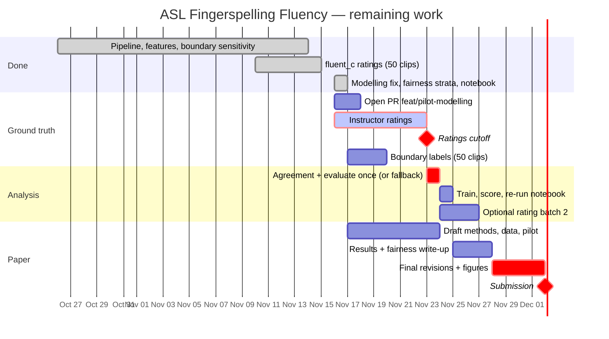

# ASL Fingerspelling Fluency Scoring

Companion code for the research proposal **"Automated Fluency and Speed Scoring for ASL
Fingerspelling"** (Steele, Kolodziej, Fogeh). The system scores *how fluently* someone
fingerspells — speed, smoothness, and consistency of letter transitions — directly from
video, instead of recognizing *what* they spelled.

**Research question:** can kinematic features from hand-landmark tracking (signing rate,
inter-letter transition smoothness, pause patterns) predict human-perceived fingerspelling
fluency?

**Hypothesis:** a model combining hand-motion kinematics with letter-segment timing
correlates significantly with human fluency ratings, outperforming a naive baseline using
only overall signing speed (letters per second).

> **Canonical documentation:** [`asl-fluency/README.md`](asl-fluency/README.md) is the
> up-to-date reference for setup, commands, the pre-registered analysis plan, and pilot
> results. Sections below this one may lag behind it. The pilot analysis notebook is
> [`asl-fluency/notebooks/01_pilot_modelling_and_fairness.ipynb`](asl-fluency/notebooks/01_pilot_modelling_and_fairness.ipynb).

## Project status

_Last updated 2026-11-16. Ratings cutoff **2026-11-23**, final deadline **2026-12-02**._

### Done

- [x] Pipeline end-to-end: `index` → `landmarks` → `features` → `rating-sheet` → `rate` →
      `agreement` → `evaluate` → `train` / `score` (76 tests passing)
- [x] Landmarks + feature table for 7,236 ChicagoFSWild clips
- [x] Boundary-sensitivity analysis on the full corpus (whole-clip features robust, ρ ≥ 0.998)
- [x] Stratified 50-clip rating sheet (27 signers); `fluent_c` rated all 50
- [x] Modelling fix: pre-registered 3-feature `core_ridge_cv` primary arm, ordinal arm,
      mean-baseline floor, paired-bootstrap hypothesis test
- [x] Objective fairness strata (`clip-context`: ITA skin-tone proxy + lighting) for rated clips
- [x] Single-rater pilot: primary arm ρ = 0.19 vs. naive 0.06 (Δρ = +0.13, p = .14, n = 50)
- [x] Pilot notebook + pre-registered analysis plan

### Remaining

| # | Task | Owner | Needs | Due |
|---|---|---|---|---|
| 1 | Open PR `feat/pilot-modelling` → `chore/rating-sheet` | Jason | — | 11-17 |
| 2 | Instructor ratings (`instructor_a`, `instructor_b`, ~10 min each via `asl-fluency rate`) | instructors | — | **11-23** |
| 3 | Hand-label letter boundaries on the 50 rated clips (`label-boundaries`) | team | — | 11-20 |
| 4 | Draft paper: intro, related work, methods, dataset, boundary sensitivity, pilot | team | — | 11-24 |
| 5 | `agreement` (ICC ≥ 0.6?) then `evaluate` **once** on the final consensus | Jason | 2 | 11-24 |
| 6 | Fallback if #2 misses the cutoff: report single-rater pilot (`evaluate --rater fluent_c`) | Jason | — | 11-24 |
| 7 | `train` + `score --from-features`; re-run the pilot notebook; fill result tables | Jason | 5 or 6 | 11-25 |
| 8 | Fairness write-up (stratified metrics, tracker-quality gap, ITA caveats) | team | 7 | 11-27 |
| 9 | Optional: rating batch 2 (`rating-sheet --batch 2`) — only if CIs too wide **and** time allows | team | 5 | 11-27 |
| 10 | Final revisions, figures, limitations; submit | team | 7, 8 | **12-02** |

Out of scope for the deadline (future work in the paper): CTC forced aligner (Roadmap Gap 1
step 3) and the video-fusion arm (Gap 2).



## Pipeline (proposal Section 4)

```
video ──► 1. landmarks    MediaPipe Hands, 21 keypoints/frame       (landmarks/)
      ──► 2. segmentation letter boundaries from the transcript     (segmentation/)
      ──► 3. features     rate, velocity/jerk, pauses, smoothness   (features/)
      ──► 4. model        naive baseline vs. ridge/GBM scorers      (models/)
      ──► 5. evaluation   Spearman/Pearson, MAE, ablations, κ/ICC   (evaluation/)
```

## Setup

```bash
cd asl-fluency
uv sync                     # core pipeline
uv sync --extra dev         # + pytest, ruff
uv sync --extra fused       # + torch, for the video-fusion ablation arm

# one-time: MediaPipe hand landmarker model (~8 MB)
curl -L -o assets/hand_landmarker.task \
  https://storage.googleapis.com/mediapipe-models/hand_landmarker/hand_landmarker/float16/1/hand_landmarker.task
```

### Platform note: MediaPipe on macOS

The project depends on MediaPipe's native hand-landmarker runtime. On some macOS
installations, the native GraphService/Metal initialization aborts before any clip is
processed, producing the error seen in the issue report:

```
F ... graph_service.h:139] Check failed: service_ Service is unavailable.
```

This is a MediaPipe runtime issue in the underlying Metal/AVFoundation stack, not a bad
model file or a broken project path. In practice, the pipeline is most reliable on a
Linux/WSL environment or any host where MediaPipe can initialize its native graph service
correctly. If the command crashes immediately on macOS, the fix is to run the project on a
supported MediaPipe runtime rather than changing the dataset or CLI arguments.

## Try it on real video

Place any fingerspelling video (or a clip extracted from ChicagoFSWild) under
`data/raw/fs_sample/` and run the demo commands below. A good test clip is
`gallaudet/mj_bienvenu_4509` from ChicagoFSWild (transcript **INTERDISCIPLINARY**,
79 frames, fluent signing); once extracted it can be reassembled to
`data/raw/fs_sample/mj_bienvenu_4509.mp4`.

```bash
# single-clip report: landmarks -> letter segmentation -> fluency features
asl-fluency demo data/raw/fs_sample/mj_bienvenu_4509.mp4 \
  --transcript INTERDISCIPLINARY --annotated-out annotated.mp4

# live mode: webcam (default --source 0) or any video file as a stand-in stream
asl-fluency live                                   # webcam, skeleton + HUD, Q to stop
asl-fluency live --source path/to/clip.mp4 --transcript HELLO --no-display \
  --save-video overlay.mp4                         # headless / file source
```

Expected on a fluent sample clip: 100% detection, ~6.5 letters/sec, letter-duration CV ≈ 0.10.

The hand selector (`SigningHandSelector`) picks the *most active* hand via fingertip-motion
EMA — on clips with a visible resting hand this is what keeps features computed on the
signing hand (continuity-only selection locks onto the wrong hand).

## Datasets (proposal Section 5)

Download manually into `data/raw/`:

| Dataset | Size | Use |
|---|---|---|
| [ChicagoFSWild](https://ttic.uchicago.edu/~klivescu/ChicagoFSWild.htm) | 7,304 clips, 160 signers | main corpus |
| ChicagoFSWild+ | 55,232 clips, 260 signers | scale-up if compute allows |
| WLASL / MS-ASL | isolated signs | hand-pose pretraining only |

**Important: ChicagoFSWild(+) clips are directories of JPEG frames, not video files.**
The pipeline handles this natively — extract the nested frames archive so clips sit in
one of these layouts (the loader auto-detects them):

```
data/raw/ChicagoFSWild.csv                     <- annotation CSV (any depth works)
data/raw/ChicagoFSWild-Frames/<signer>/<clip>/0001.jpg ...   # or
data/raw/<signer>/<clip>/0001.jpg ...                        # or
data/raw/frames/<signer>/<clip>/0001.jpg ...
```

`ChicagoFSWild.csv` alone is not sufficient; it is metadata only. You must also have
the extracted clip media (frame directories or videos) on disk.

If `ChicagoFSWild-Frames.tgz` (or `.tar.gz`) is present under `data/raw/` at any depth
(for example `data/raw/ChicagoFSWild/ChicagoFSWild-Frames.tgz`), `asl-fluency index`
will auto-extract it into `data/raw/` before resolving clip paths.

`asl-fluency index` now keeps only clips that exist locally. If no clips are found, it
fails with a setup error explaining that frame extraction is missing.

Frame directories have no native frame rate, so `landmarks.default_fps` (30) is used for
rate features. Run `asl-fluency demo data/raw/ChicagoFSWild-Frames/<signer>/<clip>
--transcript WORD` to sanity-check one clip before the batch run.

No dataset has fluency labels — collect a small human-rated subset (1–5 scale,
instructors or fluent signers) with the built-in rating-sheet tooling and the
browser rating UI (`asl-fluency rate`).

**How small can the human-rated set be?** The evaluation is a correlation
between model scores and human consensus ratings, so the sample size is a
power question: n ≈ 47 clips detects ρ = 0.4 and n ≈ 30 detects ρ = 0.5
(80% power, α = .05, two-sided). Combined with stratified sampling and the
adaptive top-up loop (`--batch 2`, `--batch 3`, …), ~50–70 clips × 3 raters
is usually enough — far below the naive 100 × 3 default. Clips are short
(median < 1 s), so a 50-clip batch is ~10 minutes per rater.

## Running the experiments

```bash
# 1. index the corpus (signer-disjoint train/val/test split)
asl-fluency index

# If this reports skipped clips, your extraction is partial; this is expected.
# It will process only clips that currently exist on disk.

# 2. extract landmarks (data/interim/landmarks/*.npz)
asl-fluency landmarks            # add --limit 50 for a quick smoke run

# 3. compute the kinematic feature table
asl-fluency features

# 4. (optional) AI-judge pre-scores over the feature pool — aids stratified
#    sampling; never part of the human ground truth. Ships with a mock backend
#    for plumbing tests; implement _score_with_backend in ai_judge.py for a
#    real VLM (prompt + clip rendering are ready).
asl-fluency ai-rate --backend mock --limit 200

# 5. stratified intake sheet (samples from features.csv — every rated clip is
#    guaranteed evaluable). Auto-stratifies on the AI score when present,
#    else letters/sec quintiles. ~50 clips x 3 raters ≈ 10 min per rater and
#    is powered to detect rho >= 0.4 at 80%.
asl-fluency rating-sheet --raters instructor_a,instructor_b,fluent_c --n-clips 50

# 6. collect ratings in the browser UI (watch, click 1-5, auto-advance;
#    saves per click, stop/resume any time)
asl-fluency rate

# 7. sanity-check ground truth: Fleiss' kappa + ICC(2,k), human raters only.
#    If ICC looks fine but the model correlation CI is too wide, top up with
#    another batch: asl-fluency rating-sheet ... --batch 2 (never re-samples
#    clips already in the sheet).
asl-fluency agreement data/ratings/ratings_intake.csv

# 8. ablation vs. consensus ratings: naive speed-only vs. kinematic arms,
#    plus stratified metrics if data/ratings/clip_context.csv exists.
#    AI-judge (vlm_*) rows are automatically excluded from the consensus.
asl-fluency evaluate data/ratings/ratings_intake.csv

# 9. boundary ground truth + sensitivity (Roadmap Gap 1): label letter spans
#    on the same rated clips in the browser, then measure how much boundary
#    error would hurt each feature
asl-fluency label-boundaries          # saves data/ratings/boundary_labels.csv
asl-fluency boundary-sensitivity      # -> data/processed/boundary_sensitivity.csv

# 10. once `evaluate` has picked a winning arm: fit it on all rated data and
#     persist the scorer, then apply it to new clips / the whole feature table
asl-fluency train --kind ridge --feature-set kinematic
asl-fluency score data/raw/fs_sample/mj_bienvenu_4509.mp4 --transcript INTERDISCIPLINARY
asl-fluency score --from-features     # score every row of features.csv
```

Ratings format (long CSV, one row per rater × clip) and the optional
`clip_context.csv` (per-clip `skin_tone`, `lighting` for the stratified fairness
evaluation) are exemplified in `data/ratings/*.example.csv`.

## Experiment map → proposal

| Proposal item | Code |
|---|---|
| RQ / hypothesis test (kinematics vs. naive speed) | `evaluation/ablation.py` arms `naive_speed_only` vs. `kinematic_*` |
| Step 1 landmarks | `landmarks/extractor.py` (Tasks API, `SigningHandSelector`), `landmarks/live.py` (webcam/stream) |
| Step 2 letter boundaries | `segmentation/aligner.py` (`uniform` + `energy_valley` shipped; `forced_alignment` is a stub hook — see Roadmap Gap 1); ground truth via `asl-fluency label-boundaries`, error tolerance via `asl-fluency boundary-sensitivity` |
| Step 3 fluency features | `features/kinematics.py` (letters/s, transition velocity/jerk, pauses, log dimensionless jerk, path efficiency) |
| Step 4 learned scorer | `models/baseline.py`, `models/fused.py` (fusion arm, `--extra fused`; deferred — see Roadmap Gap 2) |
| Step 5 human validation | `data/fluency_labels.py` (stratified sampling, human-only consensus), `asl-fluency rating-sheet` + `asl-fluency rate` (browser UI) |
| AI-judge pre-scoring (sampling aid, not ground truth) | `ai_judge.py`, `asl-fluency ai-rate` |
| Metrics: Spearman/Pearson, MAE | `evaluation/metrics.py` (+ bootstrap CIs) |
| Inter-rater agreement (κ / ICC) | `evaluation/agreement.py` |
| Skin-tone / lighting stratified eval (Section 7) | `evaluation/ablation.stratified_metrics`, `landmarks/quality.py` |

## Roadmap

Two known gaps, in the order they should be tackled. Everything else in the
pipeline (index → landmarks → features → ratings → agreement → evaluate) is
already runnable end-to-end.

### Gap 1: letter-boundary segmentation (do this first)

Every transition-zone feature (`trans_vel/jerk_*`, pause placement) is computed
relative to letter boundaries — and the RQ is precisely about whether those
features predict fluency. Global features (`letters_per_second`, duration CV,
total pause time) are far more robust to boundary error, so the first question
is not "how do I get perfect alignment" but **"how much does boundary error
actually hurt my features?"**

1. Hand-label letter boundaries on ~30–50 clips (ideally the same clips that
   get fluency ratings — one session serves both): `(clip_id, letter,
   start_frame, end_frame)` CSV under `data/ratings/`. **Tooling shipped:**
   `asl-fluency label-boundaries` opens the browser UI (scrub the flipbook,
   click the joint between letters; starts from an even split, auto-saves to
   `boundary_labels.csv`).
2. **Sensitivity analysis — shipped** as `asl-fluency boundary-sensitivity`:
   jitters uniform/energy-valley boundaries by ±2/±4/±6 frames, recomputes
   features, and rank-correlates each feature against its unperturbed self.
   Features that survive jitter need no better aligner; features that
   collapse set the alignment quality bar. This may kill the whole problem.
   First look on 20 real clips: whole-clip features (LDJ, pauses, path
   efficiency) are perfectly robust; `trans_*` statistics degrade gracefully;
   `letter_dur_std_s` / `letter_dur_cv` collapse (near-artifacts under
   uniform segmentation). **Full-corpus run (7,236 clips) confirms this**:
   ρ = 1.00 for whole-clip features, 0.71–0.90 for `trans_*`, but ≈ 0.0 /
   0.48 for `letter_dur_std_s` / `letter_dur_cv`. The artifact features are
   excluded from the `kinematic_robust` feature set, which `evaluate` runs
   as an extra ablation arm (`kinematic_robust_ridge`) so the keep/drop
   decision is made empirically against human ratings.
3. Only if needed: **CTC forced alignment** — train a letter recognizer on
   *landmark sequences* (not pixels) over ChicagoFSWild+ (clip-level
   transcripts, no frame labels: exactly the CTC setting), then Viterbi-align
   against the known transcript. Plugs directly into the existing
   `method="forced_alignment"` hook in `segmentation/aligner.py`.
4. Validate against the hand-labeled set and report boundary error in the
   paper — this directly answers Section 7's "boundary errors propagate".

### Gap 2: fusion arm (defer until labels exist)

Its only job is the kinematic-only vs. kinematic+learned ablation row, which
is meaningless until human ratings exist and ICC ≥ ~0.6 (`asl-fluency
agreement`). Section 7's warning rules out training a video model from
scratch on ~100 labels, so the choice is:

- **Frozen backbone + learned head** (safest): pretrained video encoder
  (r3d_18/Kinetics; better: a WLASL-pretrained I3D/VideoMAE, which the
  proposal already earmarks for pretraining) over each letter span, frozen,
  embeddings concatenated with the kinematic row; train only the ridge/GBM
  head. Trainable parameters stay in the dozens.
- **Learned pose encoder** (preferred): a small temporal model (TCN or
  2-layer GRU) over the 21×3 landmark sequences — still the hand-engineered
  vs. learned comparison, far cheaper than pixels, sidesteps the pixel-level
  skin-tone/lighting bias, and pretrainable self-supervised (e.g.
  masked-keypoint prediction) on all 55k unlabeled ChicagoFSWild+ clips.

Rules for either: same signer-disjoint folds as the other arms
(`cross_validate` already enforces this); compare arms on held-out test
**once** (repeated peeking with ~100 labels manufactures spurious wins);
augment only in fluency-preserving ways (brightness, crop, horizontal jitter —
never speed or temporal warping, which changes the very quantity raters
scored).

### Also shipped

- `train` / `score` commands: `evaluate` fits models only inside CV folds and
  discards them; `train` fits the chosen arm on all rated data and persists
  it to `data/processed/fluency_scorer.joblib` (joblib), and `score` applies
  the artifact to a new clip (`--transcript`) or the whole feature table
  (`--from-features`).

### Suggested overall order

1. Ratings pilot: `features` on ~1,000 clips → `rating-sheet --n-clips 50` →
   `rate` → `agreement` (ICC ≥ 0.6?). The "~100+ clips" target is reached
   adaptively: top up with `--batch 2`, `--batch 3`, … only while the Spearman
   CIs are too wide — don't pre-commit human hours the statistics may not need.
2. Boundary labels on the same clips → `boundary-sensitivity`.
3. Hypothesis test: `evaluate` (runnable end-to-end today).
4. Branch: boundaries the bottleneck → CTC aligner; else skip and say so in
   the paper. CIs too wide → next rating batch.
5. Fusion arm last — frozen/pretrained only.

## Design decisions tied to Section 7 (challenges)

- **Signer-disjoint CV everywhere** — fluency must generalize to unseen signers.
- **Interpretable scorers first** (ridge/GBM over ~18 kinematic features) because the
  rated set is small; the end-to-end fused model is an isolated ablation arm.
- **Tracking-quality covariates** (`detection_rate`, dropout runs, interframe jumps)
  travel with every feature row so degraded-tracking clips can be filtered or stratified.
- **Stratified metrics** by skin tone / lighting rather than aggregate-only reporting.

## Tests

```bash
uv run pytest          # synthetic end-to-end tests, no video data required
```

## Layout

```
.
├── assets/                          # one-time-download binary artifacts (not in git)
│   └── hand_landmarker.task         # MediaPipe HandLandmarker model (~8 MB)
│
├── configs/                         # experiment configuration overrides
│   └── default.yaml                 # all knobs: paths, model, CV, features, segmentation
│
├── data/                            # experiment data — raw, interim, processed, ratings
│   ├── interim/                     # artefacts produced during pipeline stages
│   │   ├── .gitkeep
│   │   ├── clip_index.csv           # per-clip manifest with *relative* video_path
│   │   └── landmarks/               # per-frame MediaPipe hand landmarks (*.npz)
│   │
│   ├── processed/                   # final tables ready for modelling / evaluation
│   │   └── .gitkeep                 # features.csv, ablation_results.csv, stratified_results.csv
│   │
│   ├── ratings/                     # human fluency ratings and optional context
│   │   ├── .gitkeep
│   │   ├── ratings_intake.csv       # the sheet the browser UI writes into
│   │   ├── rating_batches.csv       # per-batch strata log (adaptive collection)
│   │   ├── ratings_ai.csv           # AI-judge scores (vlm_* rows; NOT ground truth)
│   │   ├── clip_context.example.csv # example: per-clip skin_tone / lighting for stratified eval
│   │   └── ratings.example.csv      # example: long-format rater × clip ratings
│   │
│   └── raw/                         # manually-downloaded corpora (not in git)
│       ├── .gitkeep
│       ├── ChicagoFSWild/           # annotation CSVs from the official release
│       │   ├── ChicagoFSWild.csv    # main metadata: filename, label_proc, signer, partition, …
│       │   ├── HandAnnotation.csv   # hand-annotation metadata
│       │   ├── README               # official dataset README
│       │   └── individual.csv       # per-signer demographic info
│       ├── aslized/                 # extracted frame directories (<signer>/<clip>/0001.jpg)
│       └── fs_sample/               # drop a single reassembled video here for quick demo runs
│
├── notebooks/                       # exploratory analysis (Jupyter / Quarto)
│   └── .gitkeep
│
├── pyproject.toml                   # uv project metadata, deps, scripts, tool config
├── README.md                        # setup, usage, experiment map, design decisions
├── TREE.md                          # this file — annotated directory layout
├── uv.lock                          # reproducible dependency lockfile
│
├── src/
│   └── asl_fluency/                 # main pipeline package (CLI entrypoint: asl-fluency)
│       ├── __init__.py
│       ├── cli.py                   # Typer CLI: index, landmarks, features, rating-sheet,
│       │                            #   rate (browser UI), ai-rate, agreement, evaluate
│       ├── ai_judge.py              # AI-judge pre-scoring: rubric prompt, clip rendering,
│       │                            #   pluggable VLM backends (mock ships enabled)
│       ├── config.py                # YAML loading, deep-merge, path resolution, project_root()
│       │
│       ├── data/                    # dataset loaders & rating utilities
│       │   ├── __init__.py
│       │   ├── chicago_fs_wild.py   # ClipIndex, load_clip_index, signer-disjoint split, relative-path logic
│       │   ├── fluency_labels.py    # stratified sampling, rating sheets, human-only consensus, save_rating
│       │   ├── boundary_labels.py   # hand-labeled letter spans (Gap 1 ground truth) schema + storage
│       │   └── ratings_ui.py        # stdlib browser UIs: fluency rating + boundary labeling
│       │
│       ├── evaluation/              # metrics, agreement, ablation runner
│       │   ├── __init__.py
│       │   ├── ablation.py          # naive vs. kinematic arms, stratified_metrics
│       │   ├── agreement.py         # Fleiss' kappa, ICC(2,k), Cohen's kappa
│       │   ├── boundary_sensitivity.py  # boundary-jitter feature robustness (Gap 1)
│       │   └── metrics.py           # Spearman/Pearson/MAE + bootstrap CIs
│       │
│       ├── features/                # kinematic feature engineering
│       │   ├── __init__.py
│       │   ├── kinematics.py        # letters/s, velocity/jerk, pauses, path efficiency, LDJ
│       │   └── pipeline.py          # compute_feature_row, build_feature_table
│       │
│       ├── landmarks/               # MediaPipe hand-landmark extraction
│       │   ├── __init__.py
│       │   ├── extractor.py         # HandLandmarker Tasks API, SigningHandSelector, batch_extract
│       │   ├── live.py              # webcam / video-stream fluency monitor
│       │   └── quality.py           # tracking-quality covariates
│       │
│       ├── models/                  # regressors & optional fused video arm
│       │   ├── __init__.py
│       │   ├── baseline.py          # naive speed, ridge, random forest, gradient boosting
│       │   ├── persist.py           # fit/persist/load the final scorer (train/score)
│       │   └── fused.py             # kinematic + raw-video embedding ablation (needs --extra fused)
│       │
│       └── segmentation/            # letter-boundary alignment inside a clip
│           ├── __init__.py
│           └── aligner.py           # uniform, energy_valley, forced_alignment hook
│
└── tests/                           # synthetic end-to-end tests (no video data required)
    └── test_pipeline.py             # frame-dir capture, loader, segmentation, features, metrics, agreement, ablation
```

## After `boundary-sensitivity`

**1. (Optional) AI pre-scores** — only if you implement a VLM backend in `_score_with_backend`. Skipping is fine; the sampler falls back to letters/sec stratification automatically.

```bash
uv run asl-fluency ai-rate --backend <your-vlm>   # or skip entirely
```

**2. Generate the stratified intake sheet** — 50 clips spanning the speed range × 3 raters:

```bash
uv run asl-fluency rating-sheet --raters instructor_a,instructor_b,fluent_c --n-clips 50
```

**3. Collect the human data (the critical path):**

```bash
uv run asl-fluency rate                # 3 raters × 50 clips, ~10 min each
uv run asl-fluency label-boundaries    # optional now — see note below
```

**4. Sanity-check ground truth**, then the hypothesis test:

```bash
uv run asl-fluency agreement data/ratings/ratings_intake.csv   # want ICC ≥ ~0.6
uv run asl-fluency evaluate data/ratings/ratings_intake.csv    # 4 arms now, incl. kinematic_robust_ridge
```

**5. Decision point.** If the kinematic arms' Spearman CIs are decisive → done collecting. If too wide → top up and repeat 4:

```bash
uv run asl-fluency rating-sheet --raters instructor_a,instructor_b,fluent_c --n-clips 25 --batch 2
uv run asl-fluency rate
```

**6. Persist and apply the winning scorer:**

```bash
uv run asl-fluency train --kind ridge --feature-set kinematic   # whichever arm wins
uv run asl-fluency score --from-features
```

> [!NOTE]
>
> Two notes on what's optional:
>
> - **`label-boundaries`** is now a nice-to-have, not a blocker. The sensitivity analysis already answered "how much does boundary error hurt" (answer: not much, except the two artifact features). Hand labels would still let you report *actual* uniform-vs-true boundary error in the paper — a stronger Section 7 rebuttal — but it's ~30–50 clips of tedious labeling you can skip if time is short.
> - **Section 7 fairness evaluation**: if you want the stratified skin-tone/lighting metrics in the paper, someone needs to fill in `data/ratings/clip_context.csv` for the rated clips (see `clip_context.example.csv`). Without it, `evaluate` just skips that table.
